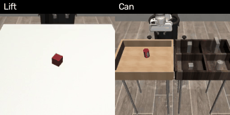

# Diffusion Policy Reimplementation

A from-scratch reimplementation of [Diffusion Policy](https://diffusion-policy.cs.columbia.edu/) for robot learning, focusing on visuomotor policy learning via conditional action diffusion.

## Demo



Diffusion Policy in the shared Franka simulation ([robot-sim](https://github.com/YahuanShi/robot-sim)): robomimic Lift and Can,
closed loop from 84×84 camera images. Real-robot demo pending (no real-robot data yet).


---

## 1. Motivation

This is a **from-scratch reimplementation** of Diffusion Policy, not a fork. Every line of code is written by hand after studying the original paper and codebase. The primary goal is to deeply understand how diffusion models work in robot action space; the secondary goal is to provide a clean, minimal codebase others can learn from.

### Differences from the Original

| Aspect | [Original (Chi et al.)](https://github.com/real-stanford/diffusion_policy) | This Project |
|--------|----------------------------------------------------------------------------|--------------|
| **Code origin** | Complete framework (~20k LOC) | From-scratch rewrite (~5k LOC incl. tests) |
| **Config system** | Hydra + YAML (dozens of config files) | Plain argparse (one `train.py`) |
| **Data format** | Zarr only | LeRobot v3 (modern standard) |
| **State normalization** | Action only | Action + state (inspired by OpenPI) |
| **Comments** | Minimal | Learning-note style: explains the *why* behind each design |
| **Environment** | conda + pip + manual setup | `bash setup.sh` one-click (uv) |

---

## 2. Diffusion Policy

Diffusion Policy is a robot learning framework from [Chi et al., 2023 (RSS)](https://diffusion-policy.cs.columbia.edu/) that applies Denoising Diffusion Probabilistic Models (DDPM) to imitation learning. Instead of directly regressing actions, the policy learns to denoise random noise into a sequence of future actions conditioned on observations.

The key insight: representing the action distribution as a learned reverse diffusion process captures multimodal behavior (e.g., going left or right around an obstacle) far better than MSE regression or Gaussian policies.

---

### 2.1 Core Concepts

#### 2.1.1 The Diffusion Policy Idea

Standard BC maps observation directly to action (unimodal, MSE regression):

```
π(obs) → action
```

Diffusion Policy instead learns the reverse of a noise-corruption process:

```
Forward: action → noisy_action  (add Gaussian noise over T steps)
Reverse: noisy_action → action  (learned denoiser conditioned on obs)
```
At inference: sample pure Gaussian noise, run the reverse process conditioned on the current observation → produces a clean action sequence. Training uses 100 DDPM noise levels; inference defaults to 16 DDIM steps over the same noise schedule (`--num_inference_steps`), ~6× faster (`scripts/benchmark_inference.py`).

**Why this works**: representing the action distribution as a reverse diffusion process naturally captures **multimodal behavior** (e.g., going left or right around an obstacle) that MSE regression or Gaussian policies collapse to the mean.

---

#### 2.1.2 Temporal Structure (Action Chunking)
The policy reasons over a temporal window, not a single timestep:

```
Timeline (H=16, To=2, Ta=8):
    predicted:  a_{t-1} | a_t a_{t+1} ... a_{t+7} | a_{t+8} ... a_{t+14}
                 ↑ obs     ↑ executed (Ta=8)        ↑ predicted, discarded
    condition:  [obs_{t-1}, obs_t]   (To=2)
```

- **Observation horizon** `To=2`: condition on the last 2 image frames
- **Prediction horizon** `H=16` (`--horizon`): the denoiser generates 16 actions at once,
  aligned so that index `To-1` is the current step
- **Action horizon** `Ta=8` (`n_action_steps`): execute only `action[To-1 : To-1+Ta]`,
  then re-plan from a new observation; the rest of the chunk is discarded

This receding-horizon control reduces compounding errors vs. single-step prediction.

---

#### 2.1.3 Network Backbone

| Backbone | Class | Conditioning Mechanism |
| --- | --- | --- |
| **1D U-Net** | `ConditionalUnet1D` | Global: concat obs_emb + step_emb via FiLM |

The original paper also supports a Transformer backbone with cross-attention. This project implements the **1D U-Net** backbone.

#### 2.1.4 Observation Mode

| Mode | Input | Vision Encoder |
| --- | --- | --- |
| **Image / Hybrid** | RGB image + low-dim state | ResNet-18 (GroupNorm) |

---

## 3. Project Architecture
```
.
├── diffusion_policy/
│   ├── model/
│   │   ├── diffusion/
│   │   │   ├── scheduler.py        # DDPM / DDIM schedulers (cosine schedule)
│   │   │   ├── unet1d.py           # Conditional 1D U-Net with FiLM conditioning
│   │   │   └── ema.py              # Exponential Moving Average for stable inference
│   │   └── vision/
│   │       └── encoder.py          # Multi-image observation encoder (ResNet18 + GroupNorm)
│   ├── dataset/
│   │   ├── normalizer.py           # Linear normalizer (limits/gaussian modes)
│   │   └── lerobot_wrapper.py      # LeRobot dataset wrapper for image policy
│   ├── policy/
│   │   ├── image.py                # Image-conditioned diffusion policy
│   │   └── loader.py               # Build policy from config, load checkpoints (EMA-aware)
│   └── control.py                  # Real-robot helpers: latency-aware chunk execution, gripper hysteresis, timing
├── training/
│   └── workspace.py                # Training loop (LeRobot pipeline, EMA, val split, checkpoints)
├── evaluation/
│   ├── offline.py                  # Predicted vs recorded action error on held-out episodes
│   ├── runner.py                   # Rollout runner with action chunking loop (mock env)
│   ├── sim_policy.py               # Adapter for the shared Franka simulation (../robot-sim)
│   └── trial_recorder.py           # Save real-robot trials (videos, actions, outcome)
├── tests/                          # pytest: scheduler, normalizer, EMA, checkpoints, control, integration
├── scripts/
│   ├── hdf5_to_lerobot.py          # HDF5 → LeRobot v3 format converter
│   ├── visualize_dataset.py        # Inspect episodes in a LeRobot dataset
│   ├── benchmark_inference.py      # DDPM vs DDIM inference latency benchmark
│   └── summarize_trials.py         # Success rate (with 95% CI) + demo GIF from recorded trials
├── experiments/                     # Validation scripts
│   ├── 01_ddpm_toy.py              # DDPM on toy 1D data
│   ├── 02_encoder_test.py          # Vision encoder unit test
│   └── 03_image_policy_test.py     # Image policy integration test
├── train.py                        # Training entry point
├── inference.py                    # Real robot inference (UR3e + dual camera)
├── eval.py                         # Evaluation entry point (offline / sim / mock)
├── setup.sh                        # One-click environment setup (uv + DP venv)
└── pyproject.toml                  # Dependencies, ruff config, project metadata
```

---

## 4. Setup

```bash
# One-click install (creates "DP" virtual environment via uv)
bash setup.sh

# Activate
source DP/bin/activate
```

Requires Python 3.10+ and a CUDA-capable GPU for training.

---

## 5. Usage

### Training

Standard format: **480×480** images, no resize, batch 64. Dataset images and inference camera frames must both be center-cropped to 480×480 square before conversion.

```bash
python train.py \
    --repo_id local/my_dataset --root ./data/my_dataset \
    --max_steps 30000 --batch_size 64 \
    --val_ratio 0.05 \
    --device cuda --output_dir outputs/my_run \
    --save_every_steps 5000 --max_keep_checkpoints 5 \
    --wandb --wandb_run_name my_run
```

- `--max_steps 30000` — total gradient steps; LR warms up linearly for `--lr_warmup_steps` (default 500), then cosine-decays to lr/10 at exactly this step
- `--val_ratio 0.05` — hold out 5% of episodes (split by episode); every `--val_every_steps` (default 2000) the EMA model is scored on them (`val/loss`, `val/action_mse`, `val/action_mae`). Default 0 = train on all episodes
- `--save_every_steps 5000` — save a step checkpoint every 5000 gradient steps; keep only the latest `--max_keep_checkpoints` (default: 3) to save disk space

`config.json` is written to `output_dir`, and the same config is stored **inside every checkpoint** — `eval.py` / `inference.py` rebuild the architecture from it, so non-default `--horizon`, `--crop`, etc. need no extra flags at load time.

Checkpoint files:
- `checkpoint_step*.pt` — raw training weights + EMA weights + optimizer state (for resuming; inference automatically uses the EMA weights)
- `policy_final.pt` — EMA weights only (for deployment)

### Resume Training
```bash
python train.py \
    --repo_id local/my_dataset --root ./data/my_dataset \
    --resume outputs/my_run/checkpoint_step20000.pt \
    --max_steps 30000 --val_ratio 0.05 --device cuda --output_dir outputs/my_run
```

With `--wandb`, resuming continues the same wandb run (wandb is off by default). Pass the same `--val_ratio` / `--seed` as the original run so the train/val split is identical.

### Evaluation

Offline (default): compares the executed action chunk `action[To-1 : To-1+Ta]` with the recorded demonstration. Uses the val episodes stored in the checkpoint unless `--episodes` is given.

```bash
python eval.py --checkpoint outputs/my_run/policy_final.pt --device cuda
python eval.py --checkpoint outputs/my_run/policy_final.pt --device cuda --episodes 3 17 42 \
    --output_json outputs/my_run/eval.json
```

Reported: denoising loss, action MSE, action MAE (overall and per dim, in raw units — degrees for UR3e joints). Low action error does not guarantee task success (multimodal demos), so use it to compare checkpoints, not as a success rate.

Simulation (closed loop, success rate): see [Simulation (Franka Panda)](#simulation-franka-panda).

Mock rollout (pipeline smoke test only, reward is meaningless):
```bash
python eval.py --checkpoint outputs/my_run/policy_final.pt --mock
```

### Simulation (Franka Panda)

While the real robot is unavailable, policies are trained and evaluated in the shared
simulation repo [`../robot-sim`](https://github.com/YahuanShi/robot-sim) (robosuite Franka Panda + robomimic demos,
converted to LeRobot v3). Evaluation uses fixed seeds, so every checkpoint is scored on
the same initial object placements.

```bash
# one-time: install robot-sim into this environment and build a dataset there
uv pip install --python DP/bin/python -e ../robot-sim
(cd ../robot-sim && .venv/bin/python -m robot_sim.convert --task lift --root data/lerobot/lift_ph_abs_84)

# train (84×84 images, random crop 76×76, absolute 10-dim actions)
python train.py --repo_id local/robomimic_lift_ph_abs_84 --root ../robot-sim/data/lerobot/lift_ph_abs_84 \
    --max_steps 30000 --batch_size 64 --crop 76 76 --output_dir outputs/sim_lift

# closed-loop evaluation: 50 seeded episodes, videos of the first 5
python eval.py --checkpoint outputs/sim_lift/policy_final.pt --device cuda \
    --sim lift --n_episodes 50 --video_dir outputs/sim_lift/videos
```

Results (50 episodes, seeds 100000–100049, 95% Wilson interval):

| Policy | Training | Lift | Can | Square |
|---|---|---|---|---|
| Diffusion Policy (U-Net) | 30k steps | **50/50 = 100%** (93–100%) | **48/50 = 96%** (87–99%) | 35/50 = 70% (56–81%) |

Lift is saturated and Can is in line with the paper (image-based Can ph: 1.00 best /
0.97 average of the last checkpoints). Square, the hardest task, reaches 70% against the
paper's 0.98 / 0.92, after far less training (30k steps ≈ 79 epochs; the paper trains
image policies for 3000 epochs). Default hyperparameters (To=2, Ta=8, horizon 16, DDIM
16 steps), untuned for these tasks.

Longer training on Square: one 150k-step run (≈ 397 epochs, cosine schedule over the full
run, `--save_every_steps 30000`), each checkpoint evaluated on the same 50 seeds:

| Checkpoint | 30k | 60k | 90k | 120k | 150k |
|---|---|---|---|---|---|
| Square | 36/50 = 72% (58–83%) | 40/50 = 80% (67–89%) | **45/50 = 90%** (79–96%) | **45/50 = 90%** (79–96%) | 42/50 = 84% (71–92%) |

Success rises from 72% to 90% by 90k steps and then plateaus (84–90%, overlapping
intervals). Best checkpoint 90% and mean over the five 83%, against the paper's 0.98 best /
0.92 average of the last 10 checkpoints, still with about 8× fewer epochs. The 30k
checkpoint here is not the 30k run above: its learning rate is still high at that point.
Each episode seeds torch with its environment seed (`DiffusionSimPolicy.reset`), so reruns
reproduce the diffusion sampling; only pixel-level EGL rendering noise remains.

`robot-sim` is not a declared dependency (CI has no `../robot-sim` checkout): the sim
tests skip when it is not installed, and a later `uv sync` removes it again.

### Real Robot Inference (UR3e)

Hardware: UR3e + Weiss CRG 30-050 gripper + dual Intel RealSense cameras.

```bash
# Install robot dependencies
pip install ur-rtde pyrealsense2 pyserial opencv-python

# Dry run (full pipeline, robot never moves — not even to home)
python inference.py --checkpoint outputs/policy_final.pt \
    --robot_ip 10.0.0.1 --dry_run

# Real deployment (control rate defaults to the training dataset's fps)
python inference.py --checkpoint outputs/policy_final.pt \
    --robot_ip 10.0.0.1 \
    --steps_per_inference 6 --num_inference_steps 16 \
    --max_steps 500
```

- `--frequency` — control rate in Hz; defaults to the dataset fps stored in the checkpoint and refuses a mismatch unless `--allow_fps_mismatch` is given
- `--steps_per_inference` — actions executed per inference cycle (default: 6 of the 8 predicted)
- `--num_inference_steps` — DDIM denoising steps (default: 16, ~6× faster than DDPM-100)
- `--max_steps` — control steps per trial (default: 800 = 40 s; the longest demo is ~33 s)
- `--max_joint_vel` — per-joint velocity clamp in rad/s (default: 1.0)
- `--num_episodes`, `--record_dir` — several trials in one session (scene reset in between), each recorded (see below)
- `--no_gripper`, `--cam_exterior`, `--cam_wrist` — run without gripper / custom camera serials

Latency compensation: action slots that elapsed during inference are skipped, and execution always stops at the cycle boundary so delays never accumulate across cycles. If inference takes longer than a whole cycle, a warning is logged and the schedule is re-anchored.

Sensors are read by background threads (one per camera, one for the gripper's serial stream), so `get_obs()` only copies the latest cached readings and never blocks the control loop; it refuses data older than 0.5 s. Each cycle logs `infer`, `obs_max` (get_obs time), `late_max` (how late an action was sent) and `age_max` (sensor age), and the run ends with the effective control rate and a timing summary. **Check these in a `--dry_run` before the first real run**: `obs_max` should stay well below the 50 ms period and the effective rate should match the dataset fps.

Gripper convention: the training data uses **1 = open, 0 = closed** (every demonstration starts and ends open). Both the gripper state fed to the policy and the gripper action channel follow it. Joint angles are in **degrees** in the data; `getActualQ()` radians are converted for the state and actions are converted back before `servoJ`. Before each trial the robot state is checked against the training range stored in the normalizer; dims far outside it are reported (catches deg/rad or gripper-polarity mismatches in a new dataset).

### Recording Trials (Demo & Success Rate)

```bash
# 20 trials; each is saved to trials/trial_<timestamp>/ (exterior.mp4, wrist.mp4,
# steps.npz, meta.json) and the operator labels it success / failure afterwards
python inference.py --checkpoint outputs/my_run/policy_final.pt --robot_ip 10.0.0.1 \
    --num_episodes 20 --record_dir trials/

# Success rate per checkpoint with a 95% Wilson interval (dry runs and unanswered trials are skipped)
python scripts/summarize_trials.py --record_dir trials/ --markdown trials/results.md

# Side-by-side camera demo GIF from one trial
python scripts/summarize_trials.py --gif trials/trial_20260212_101500 --out demo.gif
```

### Data Conversion (HDF5 → LeRobot)
```bash
python scripts/hdf5_to_lerobot.py \
    --input /path/to/hdf5_episodes \
    --repo_id local/my_dataset --root ./data/my_dataset \
    --fps 20 --state_keys qpos
```

---

## Results

Real robot: pending — no real-robot data yet. The trial tooling is in place (see
[Recording Trials](#recording-trials-demo--success-rate)); results will be filled in with
`scripts/summarize_trials.py`.

Simulation: see [Simulation (Franka Panda)](#simulation-franka-panda).

---

## Acknowledgement

Reference: [Chi et al., 2023 (RSS)](https://diffusion-policy.cs.columbia.edu/)

Source repo: https://github.com/real-stanford/diffusion_policy
